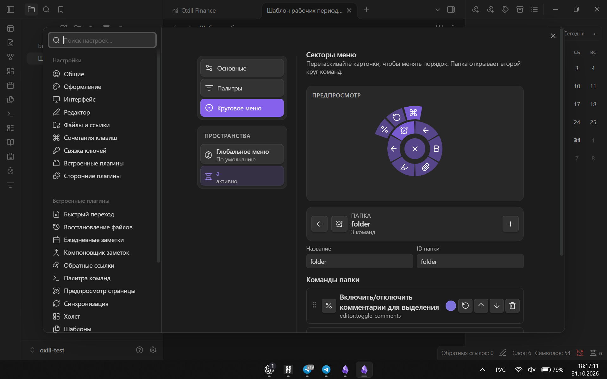

# Space Command Palette — Radial Menu and Workspace Command Palette for Obsidian

[Русская версия](README_RU.md)

**Space Command Palette** is a desktop Obsidian plugin that combines a context-aware command palette with a customizable radial menu. Create separate command sets for every saved Obsidian Workspace and open the actions you need directly beside the cursor.

> Requires Obsidian 1.13.0 or newer. Desktop only.


## Obsidian radial menu

Open the pie menu with a hotkey, point at a sector, and click to run its command. The menu supports:

- Obsidian core and community-plugin commands;
- nested command folders displayed as a second ring;
- searchable Lucide and Obsidian icons;
- individual sector colors;
- single-press or double-press activation;
- opening animation and optional navigation sounds.

## Command palettes for Obsidian Workspaces

Each saved Workspace can have its own classic command palette and radial menu. A writing layout, project dashboard, reading workspace, or knowledge base can therefore expose a different set of actions without filling one global command list.

When a Workspace has no custom radial configuration, Space Command Palette uses the global menu. When no contextual palette is configured, the standard Obsidian command palette remains available.



## Workspace and menu customization

The settings screen includes an interactive radial-menu preview and tools to:

- add, remove, reorder, and group commands;
- configure independent menus for saved Workspaces;
- assign custom Workspace icons shown in the status bar;
- rename or delete Workspaces from a context menu;
- import or export the complete configuration as JSON.

## Installation

### Obsidian Community Plugins

1. Open **Settings → Community plugins → Browse**.
2. Search for **Space Command Palette**.
3. Install and enable the plugin.
4. Enable Obsidian's built-in **Workspaces** plugin.

### Manual installation

Download `main.js`, `manifest.json`, and `styles.css` from the [latest GitHub release](https://github.com/oxilldat/space-command-palette/releases/latest). Place them in:

```text
<vault>/.obsidian/plugins/space-command-palette/
```

Restart Obsidian and enable **Space Command Palette** under Community plugins.

## Setup

1. Save at least one layout with Obsidian Workspaces.
2. Open **Settings → Space Command Palette**.
3. Choose the global menu or a specific Workspace.
4. Configure palette commands, radial sectors, folders, icons, and colors.
5. Assign hotkeys to **Open active Workspace palette** and **Open active Workspace radial menu** in Obsidian's Hotkeys settings.

## Privacy and local data

Space Command Palette works locally, contains no telemetry, and makes no network requests. Plugin settings are stored in `.obsidian/plugins/space-command-palette/data.json`; note content is never modified.

Renaming or deleting a Workspace from the plugin's context menu also updates the saved Workspace in Obsidian. Settings from Space Command Palette 0.1.x are migrated automatically.

## Compatibility notice

Obsidian does not currently expose a public API for identifying and managing the active saved Workspace. This plugin isolates its use of the internal Workspaces instance, but major Obsidian updates may require a compatibility update.

## License

MIT © 2026 oxill. See [LICENSE](LICENSE).
