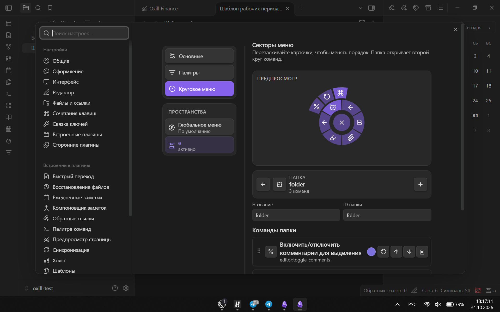

# Space Command Palette — круговое меню и палитра команд для Obsidian

[English version](README.md)

**Space Command Palette** — настольный плагин для Obsidian, который объединяет контекстную палитру команд и настраиваемое круговое меню. Для каждого сохранённого рабочего пространства можно создать отдельный набор действий и открывать нужные команды рядом с курсором.

> Требуется Obsidian 1.13.0 или новее. Только для компьютеров.


## Круговое меню команд Obsidian

Нажмите назначенную горячую клавишу, наведите курсор на сектор и выберите команду. Круговое меню поддерживает:

- команды Obsidian и сторонних плагинов;
- вложенные папки команд в виде второго кольца;
- поиск среди иконок Lucide и Obsidian;
- отдельный цвет каждого сектора;
- одинарное или двойное нажатие горячей клавиши;
- анимацию появления и необязательные звуки навигации.

## Отдельные палитры для Workspaces

Каждое сохранённое пространство Obsidian может иметь собственную классическую палитру команд и отдельное radial menu. Пространства для работы, чтения, ведения проектов и базы знаний больше не обязаны использовать один перегруженный список действий.

Если для активного Workspace не настроено отдельное круговое меню, используется глобальный набор. Если контекстная палитра отсутствует, стандартная палитра команд Obsidian остаётся доступной.



## Настройка пространств и команд

В настройках доступен интерактивный предпросмотр кругового меню. Здесь можно:

- добавлять, удалять и перетаскивать команды;
- объединять команды во вложенные папки;
- создавать отдельные меню для сохранённых Workspaces;
- назначать пространствам иконки, отображаемые в строке состояния;
- переименовывать и удалять пространства через контекстное меню;
- импортировать и экспортировать всю конфигурацию в JSON.

## Установка

### Через каталог плагинов Obsidian

1. Откройте **Настройки → Сторонние плагины → Просмотр**.
2. Найдите **Space Command Palette**.
3. Установите и включите плагин.
4. Включите встроенный плагин Obsidian **«Пространства»**.

### Ручная установка

Скачайте `main.js`, `manifest.json` и `styles.css` из [последнего релиза на GitHub](https://github.com/oxilldat/space-command-palette/releases/latest) и поместите их в папку:

```text
<vault>/.obsidian/plugins/space-command-palette/
```

Перезапустите Obsidian и включите **Space Command Palette** в разделе сторонних плагинов.

## Первоначальная настройка

1. Сохраните хотя бы одну компоновку через встроенный плагин «Пространства».
2. Откройте **Настройки → Space Command Palette**.
3. Выберите глобальное меню или конкретный Workspace.
4. Настройте команды палитры, круговые секторы, папки, иконки и цвета.
5. Назначьте горячие клавиши командам **Открыть палитру активного Workspace** и **Открыть круговое меню активного Workspace**.

## Конфиденциальность и локальные данные

Space Command Palette работает локально, не содержит телеметрии и не выполняет сетевые запросы. Настройки хранятся в `.obsidian/plugins/space-command-palette/data.json`; содержимое заметок не изменяется.

Переименование или удаление Workspace через контекстное меню плагина также изменяет сохранённое пространство Obsidian. Настройки Space Command Palette 0.1.x мигрируют автоматически.

## Совместимость

Obsidian пока не предоставляет публичный API для определения и управления активным сохранённым Workspace. Работа с внутренним экземпляром Workspaces изолирована в отдельном модуле, однако после крупных обновлений Obsidian может потребоваться обновление совместимости.

## Лицензия

MIT © 2026 oxill. Подробнее в [LICENSE](LICENSE).
